<a href="https://domeepc.github.io/domeepc-Portfolio/">
   computer engineering student / embedded C/C++ @ FESB Racing / java intern @ Abysalto / full-stack typescript dev. Based in Kaštela, Split, Croatia." />
</a>

  
  
  

<a href="https://domeepc.github.io/domeepc-Portfolio/#about">
  
</a>

<a href="https://domeepc.github.io/domeepc-Portfolio/#skills">
  
</a>

<a href="https://domeepc.github.io/domeepc-Portfolio/#projects">
  
</a>
<a href="https://github.com/domeepc/activitysearch">
  
</a>
<a href="https://github.com/domeepc/Changing-gear-alg">
  
</a>
<a href="https://github.com/domeepc/i_life">
  
</a>

<a href="https://domeepc.github.io/domeepc-Portfolio/#experience">
  
</a>

<a href="https://domeepc.github.io/domeepc-Portfolio/#contact">
  
</a>

  
  <a href="https://github.com/domeepc?tab=repositories"></a>
  
  


<!-- Panels are generated: edit scripts/build.mjs, then run `node scripts/build.mjs`. -->
